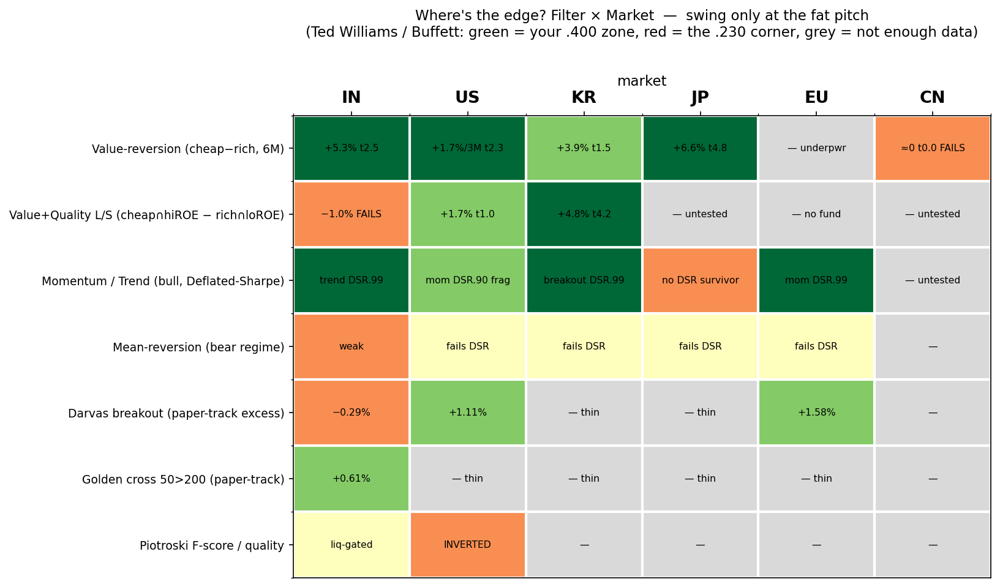

# Market screener RAG — per-market winning strategies, offline

A credit-free, offline retrieval + screening tool for equity investors and researchers. It
holds the backtested, multiple-testing-survived "winning strategy" for each of six markets
(India, US, Korea, Japan, Europe, China) in a small JSON knowledge base, reports each
strategy's historical earnings, applies the winning screen to a bundled snapshot of
fundamentals to print stock picks (long and, where the market allows, short), and answers
free-text questions with TF-IDF retrieval over the knowledge base. Output is Markdown on
stdout plus a filter × market "edge matrix" (CSV + PNG).

> Status: research-only snapshot. Research and education only — NOT investment advice.
> All earnings are gross of costs and short-borrow, on survivorship-biased universes; read
> spreads, not levels. No paid API, no model download; every number traces to a committed
> point-in-time backtest and is never invented.

> **Walkthrough:** [How-to post on masaladeutsch](https://masaladeutsch.blogspot.com/2026/10/how-to-use-marketscreenerrag-backtested.html) · [Video on YouTube](https://www.youtube.com/watch?v=3hloP1KwL5I)

> **More videos:** [Longer walkthrough](https://www.youtube.com/watch?v=CvVA479MN_A)

<!-- how-to-use-with-ai -->
> **New here?** See [How to use this repo with AI](HOW_TO_USE_WITH_AI.md) and the plain-English
> [GLOSSARY.md](GLOSSARY.md) (momentum, PE, t-stat, Deflated Sharpe …).

## What it does
- `strategy <market>` — character, book, winning metrics, screen rule, backtested earnings and verdict for one market, from `winning_strategies.json`.
- `screen <market>` — applies the market's winning screen to `data/valuation_clusters.csv` and prints the top 15 picks (India long-only, Korea long/short, US short-horizon long). Bundled clusters exist for India, US and Korea only; other markets report "no bundled fundamentals".
- `earnings` — one table of every strategy's historical earnings and significance.
- `universal` — the metric that works in (nearly) every market.
- `playbook [market]` — retail-accessible edges ranked per market, plus the rules that hold everywhere.
- `ask "<question>"` — TF-IDF (scikit-learn) retrieval over the strategy corpus; a bare query without a command does the same.
- `edge_matrix.py` — renders the filter × market fat-pitch grid to `reports/edge_matrix.{csv,png}`.

## Quick start
```bash
git clone https://github.com/herrrickshaw/market_screener_rag.git
cd market_screener_rag
python -m venv .venv && source .venv/bin/activate
pip install -r requirements.txt
python screener_rag.py screen KR          # Korea long/short picks from the winning screen
```

More commands:
```bash
python screener_rag.py strategy KR        # winning Korea strategy + its earnings
python screener_rag.py screen IN          # apply the India winning screen -> live picks
python screener_rag.py earnings           # historical earnings of every strategy
python screener_rag.py universal          # the metric that works in every market
python screener_rag.py playbook           # ranked edges for all markets (or: playbook JP)
python screener_rag.py ask "why long-only in india"
pip install matplotlib numpy && python edge_matrix.py   # reports/edge_matrix.{csv,png}
```

## Where's the edge? The fat-pitch grid



Ted Williams only swung at pitches in his .400 zone; Buffett borrowed it — *wait for the fat
pitch.* This grid (`edge_matrix.py`) maps every filter/strategy × market to its backtested
edge: green = swing (validated edge), red = take the pitch (fails), grey = not enough data.
The whole platform reduces to two green rows — **value-reversion** (IN/US/KR/JP) and
**momentum** (IN/KR/EU); everything else is grey or red.

## The winning strategy per market (backtested, point-in-time)

| market | character | book | winning metric | historical earnings | significance |
|---|---|---|---|---|---|
| **India** | momentum/trend | **long-only** | trend + sector-relative cheapness | value **+5.3%/6M** (≈+10.9%/yr); trend IR 2.34 | t 2.5 · DSR **0.994** |
| **Korea** | mean-reversion | **full long/short** | cheap∩hi-ROE − expensive∩lo-ROE | **+4.83%/6M** (≈+9.9%/yr) — strongest | t **4.17** · DSR 0.99 |
| **US** | mixed/light | long-tilt | short-horizon cheap-vs-market | **+1.72%/3M** (≈+6.9%/yr) | t 2.32 (fades by 6M) |
| **Japan** | value-reversion | long cheap-vs-market | cheap-vs-market (low PE) | **+6.6%/6M** (t 4.84) — deep EDINET | powered (EDINET-Bench, no key) |
| **Europe** | momentum (bull) | directional | 12-month momentum | IR 1.39 (bull) | DSR 0.985 · value underpowered |
| **China** | momentum/retail | — | value **tested & fails** | cheap−rich ≈ 0% (t 0.04) — powered null | value edge absent, tested |

**The universal finding:** momentum/trend (bull regime) is the one metric that works in
nearly every market and survives the Deflated-Sharpe multiple-testing correction (India
trend, Korea breakout, Europe momentum). Value-reversion works where powered — India,
Korea, US and Japan (once deep EDINET data was added) — and fails in China (a real null).
Japan's flip is the lesson: its earlier "underpowered" verdict was a data-depth artefact.

## How it works

| Stage | Module | Output |
|---|---|---|
| Knowledge base | `winning_strategies.json` | per-market character, book, winning metrics, screen rules, backtest earnings (t-stats, DSR), sufficiency, verdict |
| Normalise market | `screener_rag.normalise_market` | free text / code → `IN US KR JP EU CN` |
| Load snapshot | `screener_rag.load_clusters` | `data/valuation_clusters.csv` filtered to one market |
| Select picks | `screener_rag.SCREENS` registry (`_screen_in`, `_screen_kr`, `_screen_us`, default) | pure functions: clusters frame in, (heading, frame) pairs out |
| Format | `screener_rag.screen / strategy / earnings / universal / playbook` | Markdown text |
| Retrieve | `screener_rag.build_corpus` + `ask` | TF-IDF best-match document |
| CLI | `screener_rag.dispatch` → `main` | stdout |
| Edge grid | `edge_matrix.MATRIX` → `matrix_frame` / `fat_pitches` / `render_heatmap` → `write_outputs` | `reports/edge_matrix.csv`, `.png` |

Design decisions:
- **Rule-based, not an LLM.** The "RAG" is a JSON knowledge base plus TF-IDF retrieval, so it runs offline with no credits and cannot hallucinate numbers.
- **Screens are a registry of pure functions.** Thresholds (`CHEAP_Z = -0.8`, `RICH_Z = 1.0`, ROE gates 15% / 10% / 5%, 15 picks) are named constants; adding a market adds an entry to `SCREENS` without touching `screen()`.
- **Data is bundled as plain git objects** (not LFS) so the screener runs standalone from a clone.

## Repository layout
| Path | Purpose |
|---|---|
| `screener_rag.py` | CLI + library: strategy / screen / earnings / universal / playbook / ask |
| `edge_matrix.py` | fat-pitch grid builder (CSV + heatmap) |
| `winning_strategies.json` | the strategy knowledge base (tracked, hand-curated from backtests) |
| `data/valuation_clusters.csv` | bundled peer-valuation clusters (IN/US/KR; `pe pb roe valuation_z verdict …`) used by `screen` |
| `data/all_ratios.csv` | bundled fundamentals ratios snapshot (six markets); not read by the current code |
| `edge_matrix.csv`, `*.png` | published outputs (tracked); `edge_matrix.py` regenerates into `reports/` (gitignored) |
| `tests/` | pytest unit + smoke tests |
| `GLOSSARY.md`, `WHY_THESE_WIN.md`, `MARKET_PLAYBOOK.md`, `FUNDAMENTALS_VS_SPECULATION.md`, `PROJECT_RETROSPECTIVE.md` | companion write-ups |
| `graphify-out/` | generated knowledge-graph artefacts (not source) |

## Data sources
| Source | What is taken | Access route | Licence / caveat |
|---|---|---|---|
| yfinance, SEC EDGAR, DART (via the upstream research platform; `source` column) | fundamentals ratios and peer clusters, computed 2026-07-23 (`computed_at`), closes 2026-05-27 … 2026-07-23 | bundled CSV, no live fetch | survivorship-biased universe; point-in-time lagging applied upstream |
| EDINET-Bench (Sakana AI, arXiv:2506.08762) | deep Japan fundamentals panel used in the Japan backtest | upstream only; not bundled | task-sample (~1,437 firms), so Japan magnitudes may be biased |

The backtests themselves (t-stats, DSR, earnings) are reproduced from the upstream multi-market
research platform and recorded in `winning_strategies.json`; this repo does not rerun them.

## Configuration
No environment variables and no secrets. Paths are relative to the repo root
(`screener_rag.KB_PATH`, `screener_rag.CLUSTERS_PATH`, `edge_matrix.REPORTS_DIR`) and can be
overridden by passing `kb=` / `clusters_path=` / `out_dir=` to the library functions.

## Testing
```bash
pip install pytest ruff matplotlib numpy
ruff check .
pytest -q          # 32 tests
```

## Assumptions (they bound every number)
1. **Point-in-time.** Fundamentals are lagged to when they were public — `filed` date where available, else fiscal-year-end + 90 days (120 for China's Apr-30 deadline).
2. **Survivorship bias → read spreads, not levels.** Cross-sectional spreads (Q1−Q5, long−short) largely cancel the market-wide bias; absolute returns are inflated.
3. **Gross of costs.** Net edge must clear square-root impact cost and, for shorts, locate + borrow. Korea L/S roughly halves net of 5% borrow; US L/S turns negative.
4. **Capacity is small and illiquidity-driven**: ~$300–500k before decay, dead by ~$10M.
5. **Non-overlapping observations** for t-stats; ≥15 obs → powered. Japan looked "dead" until deep data arrived.
6. **Coverage** = |fundamentals ∩ liquid universe| / |liquid universe|; below ~60% results are flagged "returns-only".
7. **Sample representativeness.** Japan's panel is the EDINET-Bench task-sample, so its magnitude may be biased even though direction and significance (t 4.84) are decisive.

A finding is trusted only when t ≳ 2 AND (for technical factors) DSR > 0.95 AND ≥ 15 obs AND
≥ 60% coverage. Short on power → "can't conclude"; short on coverage only → "returns-only".

## Limitations and known issues
- `screen` only has bundled clusters for India, US and Korea; Japan, Europe and China print "no bundled fundamentals" (see `PROJECT_RETROSPECTIVE.md`).
- Market detection is by substring (`normalise_market`): a question containing "in" or "us" as part of another word is read as India / US.
- `ask` is TF-IDF best-match over seven short documents — it returns the closest existing note, not a generated answer.
- The bundled snapshot is static (2026-07-23); nothing refreshes it.
- Piotroski F-score is inverted in the US in these backtests — factors do not travel across markets.

## Literature
- Multiple testing / backtest overfitting: Bailey & López de Prado (2014), *The Deflated Sharpe Ratio*, JPM; Harvey, Liu & Zhu (2016), RFS; Harvey & Liu (2015), *Backtesting*, JPM.
- Value / mean-reversion: De Bondt & Thaler (1985), JF; Lakonishok, Shleifer & Vishny (1994), JF; Fama & French (1992).
- Momentum: Jegadeesh & Titman (1993), JF; Moskowitz, Ooi & Pedersen (2012), *Time Series Momentum*, JFE.
- Quality: Piotroski (2000), J. Accounting Research.
- Execution and capacity: Almgren & Chriss (2000); Almgren et al. (2005); Amihud (2002), JFM; Corwin & Schultz (2012), JF.
- Factor selection: Tibshirani (1996), Lasso, JRSS-B. Microstructure context: Gomber, Arndt, Lutat & Uhle (2011), SSRN 1858626; the `baobach/hft_papers` reading list.
- Japan panel: Sugiura et al. (2025), *EDINET-Bench* (Sakana AI), arXiv:2506.08762 — also independent corroboration that a naive persistence (momentum) baseline is hard to beat.

## Licence
No licence file yet — all rights reserved. Descriptive research pipeline. Not investment advice. No warranty.
